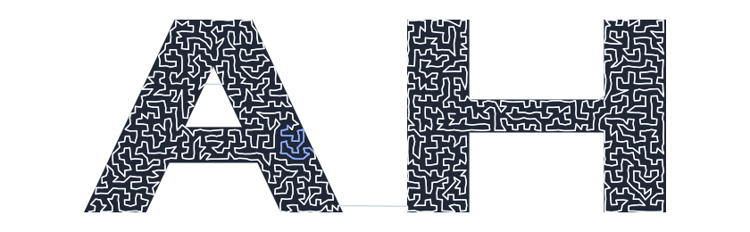

  <picture>
    <source media="(prefers-color-scheme: dark)" srcset="art/signature-dark.svg">
    
  </picture>

## Andrew Hu

I build search systems and data infrastructure at [Pithecene](https://pithecene.sh).

[Website](https://andrewhu.nyc) · [Software](https://andrewhu.nyc/software) · [About the signature](art/)

### Latest releases

<!-- releases:start -->
- [suds v0.1.2](https://github.com/pithecene/suds/releases/tag/v0.1.2) · 2026-11-20
- [quarry v0.18.0](https://github.com/pithecene/quarry/releases/tag/v0.18.0) · 2026-11-12
- [lode v0.17.1](https://github.com/pithecene/lode/releases/tag/v0.17.1) · 2026-11-12
<!-- releases:end -->
