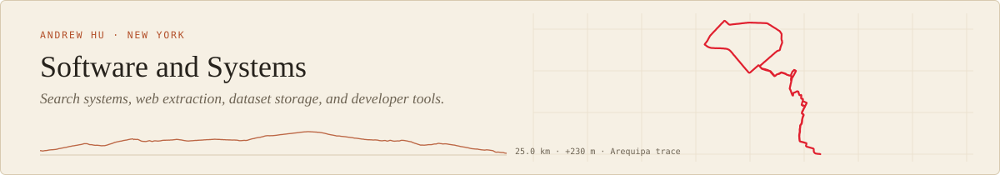

<picture>
  <source media="(prefers-color-scheme: dark)" srcset="assets/header-dark.svg">
  
</picture>

I design and build domain-specific search engines, analytical platforms, and shared data and engineering infrastructure. Through [Pithecene](https://pithecene.sh), I develop systems for maritime operations, civic and economic inquiry, and financial markets alongside open-source foundations; outside Pithecene, I build independent tools and write essays and recollections at [andrewhu.nyc](https://andrewhu.nyc).

**[Browse the full software catalogue at andrewhu.nyc/software →](https://andrewhu.nyc/software)**

---

### Selected Software

- **[Quarry](https://pithecene.sh/foundations/quarry)** · [Source](https://github.com/pithecene/quarry) · [Documentation](https://pithecene.sh/docs/quarry) · [JSR](https://jsr.io/@pithecene/quarry-sdk)  
  CLI-first web extraction runtime for imperative Puppeteer and HTTP scripts. Keeps navigation and extraction logic in a freestanding TypeScript script while a separate runtime enforces ordering, ingestion policies (`strict`, `buffered`, `streaming`), inspectable run outcomes, and durable filesystem or S3 storage. *(Published through Pithecene, Apache 2.0)*

- **[Lode](https://pithecene.sh/foundations/lode)** · [Source](https://github.com/pithecene/lode) · [Documentation](https://pithecene.sh/docs/lode) · [pkg.go.dev](https://pkg.go.dev/github.com/pithecene/lode/lode)  
  Embeddable Go persistence library for object and filesystem storage without a database. Separates stored bytes from published state through immutable snapshots, caller-supplied metadata, and compare-and-swap manifest commits, with an experimental `lode/volume` package for sparse byte ranges. *(Published through Pithecene, Apache 2.0)*

- **[Grove](https://pithecene.sh/foundations/grove)** · [Source](https://github.com/pithecene/grove)  
  Read-only stewardship record for long-lived software portfolios. Compares a repository's maintainer-declared purpose, horizon, role, and phase (`.grove.yaml`) with observed structural change over time without scoring or ranking. *(Published through Pithecene)*

---

### Wider Corpus & Writing

GitHub pins hold only a small slice across organizations. The curated personal view—covering purpose, technical choices, representative results, affiliations, and work across stages—lives at **[andrewhu.nyc/software](https://andrewhu.nyc/software)**.

- **Software catalogue:** [andrewhu.nyc/software](https://andrewhu.nyc/software)
- **Personal site, notes & work:** [andrewhu.nyc](https://andrewhu.nyc) · [Work](https://andrewhu.nyc/work)
- **Pithecene engineering:** [pithecene.sh](https://pithecene.sh)
