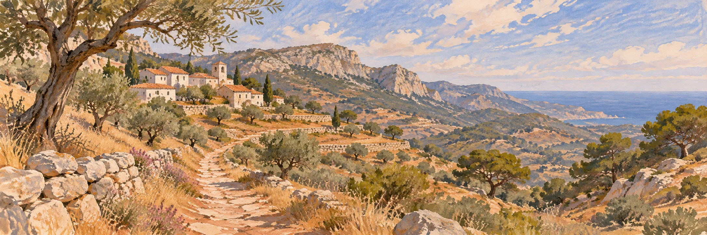

# Andrew Hu

I build software for search, data systems, and computation at [Pithecene](https://pithecene.sh).

## Selected Projects

- **[Quarry](https://github.com/pithecene/quarry)**: Web data extraction.
- **[Lode](https://github.com/pithecene/lode)**: Versioned data storage.
- **[Dao](https://github.com/pithecene/dao)**: A programming language for structured computation.
- **[Jade](https://github.com/play-jade/jade)**: A place to play, study, and explore Xiangqi.

[Website](https://andrewhu.nyc) · [Software](https://andrewhu.nyc/software) · [Notes](https://andrewhu.nyc/#notes)

Latest releases

<!-- releases:start -->
- [lode v0.18.0](https://github.com/pithecene/lode/releases/tag/v0.18.0) · 2026-11-20
- [suds v0.1.3](https://github.com/pithecene/suds/releases/tag/v0.1.3) · 2026-11-20
- [quarry v0.18.0](https://github.com/pithecene/quarry/releases/tag/v0.18.0) · 2026-11-12
<!-- releases:end -->

